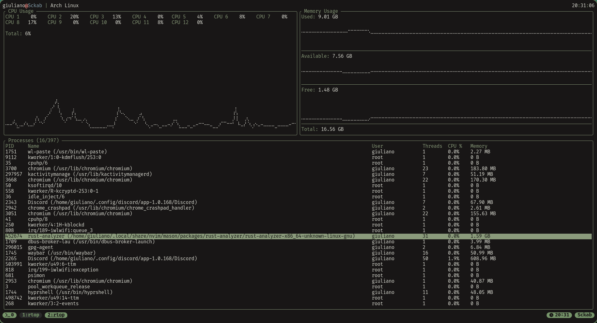

<div align="center">

# RTOP

_A Rust TOP_

[](https://www.rust-lang.org/)
[](LICENSE)



RTOP is a fast, terminal-based system monitor written in Rust, inspired by `top`.
It shows CPU and memory usage with live history graphs, plus a sortable and
filterable process list with the ability to terminate processes.

</div>

## Features

- **Live CPU monitoring** — total usage, per-core usage, and a scrolling history graph.
- **Live memory monitoring** — used, available, and free memory, each with its own scrolling history graph; total memory is shown as a value.
- **Process list** — PID, name (with executable path), user, thread count, CPU %, and memory usage.
- **Sorting and filtering** — sort by any column with `Alt`-based shortcuts, hold `Shift` for descending, and filter by process name or executable path.
- **Kill processes** — with a confirmation prompt, a start-time check to avoid killing a recycled PID, and an error toast if the operation fails.
- **Vim-style keybindings** — `j`/`k`/`g`/`G` for navigation, `h`/`?` for help, `q` to quit, plus `Alt`-based sorting.
- **Responsive layout** — per-core CPU stats are laid out in multiple columns based on terminal width.
- **Non-blocking sampling** — system data is collected on background threads, so the UI stays responsive.

## Requirements

- Rust **1.95+** (the project uses the 2024 edition).
- Linux, macOS, Windows, or another platform supported by [`sysinfo`](https://crates.io/crates/sysinfo).
- A terminal with UTF-8 and color support.
- A [Nerd Font](https://www.nerdfonts.com/) is recommended to render the sorting
  arrows in the process header; without one they may appear as missing glyphs.

## Installation

### From source

```bash
git clone https://github.com/Sckab/rtop.git
cd rtop
cargo build --release
./target/release/rtop
```

To install the binary into `~/.cargo/bin`:

```bash
cargo install --path .
```

Or install directly from the repository:

```bash
cargo install --git https://github.com/Sckab/rtop.git
```

## Usage

```bash
rtop
```

RTOP takes no command-line arguments (other than `--help` and `--version`) and
has no configuration file: it starts in the alternate screen and exits with `q`
or `Esc`.

### Keybindings

| Key        | Action                            |
| ---------- | --------------------------------- |
| `h`, `?`   | Show / hide the help panel        |
| `q`, `Esc` | Quit (or close the current panel) |
| `k`, `↑`   | Select the previous process       |
| `j`, `↓`   | Select the next process           |
| `g`, `←`   | Select the first process          |
| `G`, `→`   | Select the last process           |
| `K`        | Kill the selected process         |
| `/`        | Filter processes                  |
| `Esc`      | Cancel the filter input           |
| `Enter`    | Confirm the filter                |

Sorting shortcuts:

| Key       | Action                  |
| --------- | ----------------------- |
| `Alt + p` | Sort by PID             |
| `Alt + n` | Sort by process name    |
| `Alt + e` | Sort by executable path |
| `Alt + u` | Sort by user            |
| `Alt + t` | Sort by thread count    |
| `Alt + c` | Sort by CPU usage       |
| `Alt + m` | Sort by memory usage    |
| `Alt + r` | Reset process sorting   |

Selecting a column sorts in ascending order by default; hold `Shift` while
pressing the shortcut (e.g. `Shift + Alt + c`) to sort in descending order.
Sorting is applied to the filtered process list, and the active column is marked
with an arrow in the process table header (`(exe)` is shown when sorting by
executable path).

Inside the kill confirmation dialog:

| Key                  | Action           |
| -------------------- | ---------------- |
| `y`, `Enter`         | Confirm the kill |
| `n`, `N`, `q`, `Esc` | Cancel           |

Navigation wraps around: pressing `j` on the last process jumps to the first one,
and `k` on the first process jumps to the last one.

## Interface

The screen is divided into three areas:

1. **Header** — `user@host | OS` on the left, current local time on the right.
2. **CPU and memory panels** — side by side. The CPU panel lists per-core usage,
   total CPU usage, and a braille history graph. The memory panel shows used,
   available, and free memory with their graphs, plus total memory as a value.
3. **Process table** — all visible processes with the currently selected one
   highlighted. The panel title shows the selected position and the total number
   of processes, e.g. `Processes (3/214)`, and appends `Search: <query>` while a
   filter is active. The header marks the active sort column with an arrow.

Additional overlays:

- **Help panel** (`h` / `?`) — static panel with two sections, **General** and
  **Sorting**; close it with `h`, `?`, `q`, or `Esc`.
- **Kill confirmation** (`K`) — asks for confirmation before sending the signal.
- **Error toast** — appears in the top-right corner for 3 seconds if a process
  cannot be killed (e.g. insufficient permissions).
- **Filter input** (`/`) — filters processes by name or executable path and
  updates the list as you type. Press `Enter` to keep the filter or `Esc` to
  clear it.

> Note: killing a process requires the appropriate permissions. On Unix systems,
> the process is terminated with `SIGKILL`, and processes owned by other users can
> only be killed by root. RTOP also checks the process start time before sending
> the signal, so a recycled PID is not killed by mistake.

## How It Works

RTOP uses three threads:

- **UI thread** — renders with [`ratatui`](https://crates.io/crates/ratatui) and
  [`crossterm`](https://crates.io/crates/crossterm), polls terminal events every
  100 ms, and redraws only when something changed.
- **Stats thread** — samples CPU and memory via [`sysinfo`](https://crates.io/crates/sysinfo)
  at `sysinfo::MINIMUM_CPU_UPDATE_INTERVAL`, keeps a bounded history, and renders
  only the samples that fit in the graph, so scrolling starts as soon as the
  visible window fills.
- **Process thread** — refreshes the process list every 500 ms and handles kill
  requests sent by the UI.

The threads communicate through `std::sync::mpsc` channels, so sampling never
blocks input handling or rendering. Display strings are precomputed once per
refresh rather than on every frame.

## Development

```bash
cargo run              # Run in debug mode
cargo build --release  # Optimized build
cargo fmt              # Format code
cargo clippy           # Run lints
```

## Limitations

- No configurable refresh intervals or themes.
- Sorting and filter state are not persisted between runs.
- No tree visualization of the processes.
- Process names and executable paths for processes owned by other users may be
  unavailable on some platforms.
- Killing processes is the only write operation performed by the application.

## License

Distributed under the terms of the **GNU General Public License v3.0**.
See [LICENSE](LICENSE) for the full text.
