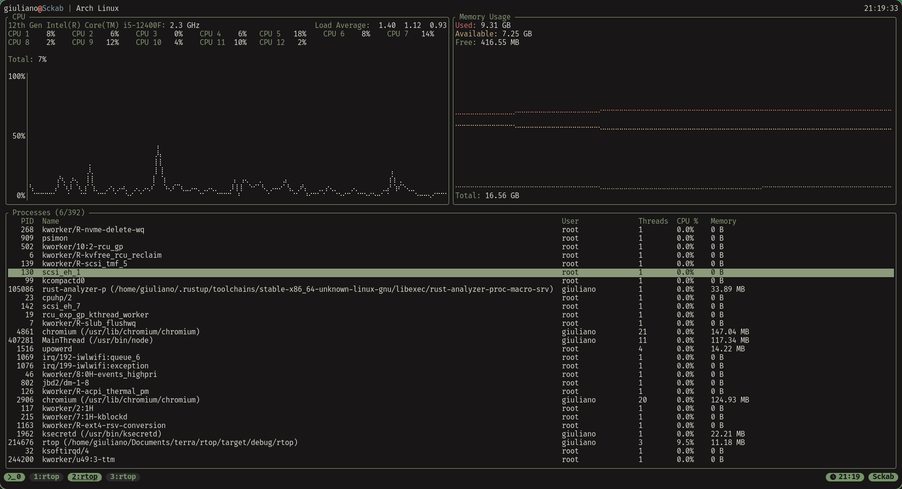

<div align="center">

# RTOP

_A Rust TOP_

[](https://www.rust-lang.org/)
[](LICENSE)



RTOP is a fast, terminal-based system monitor written in Rust, inspired by `top`.
It shows CPU and memory usage with live history graphs, live hardware
temperatures, disk usage, and network throughput, plus sortable process,
temperature, and disk tables; the process list can be filtered and processes
can be terminated.

</div>

## Features

- **Live CPU monitoring** — CPU brand and average frequency, load average (1, 5, and 15 minutes; Unix only), total and per-core usage, and a scrolling history graph.
- **Live memory monitoring** — used, available, and free memory in a combined scrolling history graph; total memory is shown as a value. On Windows, available and free are identical, so only free is listed.
- **Temperature monitoring** — lists hardware sensors with their current temperature in a selectable, sortable table, refreshed every second. The selected sensor is preserved across refreshes and sorting. Available sensors depend on the platform and drivers; unavailable readings are shown as `Unknown`.
- **Network monitoring** — aggregate RX/TX speed and total received/transmitted bytes, with a scrolling braille history graph. Loopback and common virtual interfaces (Docker, libvirt, VMware, VirtualBox) are excluded.
- **Disk usage** — per-filesystem name, mount point, used and available space, total size, and read/write counters, refreshed every second, in a selectable and sortable table. The selected disk is preserved across refreshes and sorting.
- **Process list** — PID, name (with executable path), user, thread count, CPU %, and memory usage.
- **Sorting and filtering** — sort the process, temperature, and disk tables with `Alt`-based shortcuts, hold `Shift` for descending, and filter processes by name or executable path. The active sort column is marked with an arrow.
- **Kill processes** — with a confirmation prompt, a start-time check to avoid killing a recycled PID, and an error toast if the operation fails.
- **Vim-style keybindings** — `j`/`k`/`g`/`G` for navigation in the focused panel, `K`/`J`/`H`/`L` to move focus between panels, `h`/`?` for the scrollable help, `q` to quit, plus `Alt`-based sorting.
- **Responsive layout** — per-core CPU stats are laid out in multiple columns based on terminal width.
- **Non-blocking sampling** — system data is collected on background threads, so the UI stays responsive.

## Requirements

- Rust **1.95+** (the project uses the 2024 edition).
- Linux, macOS, Windows, or another platform supported by [`sysinfo`](https://crates.io/crates/sysinfo).
- A terminal with UTF-8 and color support.

## Installation

### From source

```bash
git clone https://github.com/Sckab/rtop.git
cd rtop
cargo build --release
./target/release/rtop
```

To install the binary into `~/.cargo/bin`:

```bash
cargo install --path .
```

Or install directly from the repository:

```bash
cargo install --git https://github.com/Sckab/rtop.git
```

## Usage

```bash
rtop
```

RTOP takes no command-line arguments (other than `--help` and `--version`) and
has no configuration file: it starts in the alternate screen and exits with `q`
or `Esc`.

### Keybindings

| Key        | Action                                       |
| ---------- | -------------------------------------------- |
| `K`        | Focus the Processes panel                    |
| `J`        | Focus the Disks panel (from Processes)       |
| `H`        | Focus the Temperatures panel (from Disks)    |
| `L`        | Focus the Disks panel (from Temperatures)    |
| `h`, `?`   | Show / hide the help panel                   |
| `q`, `Esc` | Quit (or close the current panel)            |
| `k`, `↑`   | Select the previous row in the focused panel |
| `j`, `↓`   | Select the next row in the focused panel     |
| `g`, `←`   | Select the first row in the focused panel    |
| `G`, `→`   | Select the last row in the focused panel     |
| `Alt + D`  | Kill the selected process                    |
| `/`        | Filter processes                             |
| `Esc`      | Cancel the filter input                      |
| `Enter`    | Confirm the filter                           |
| `Alt + r`  | Reset sorting for the focused panel          |

Navigation wraps within the focused panel: pressing `j` on the last row jumps to
the first one, and `k` on the first row jumps to the last one. `/` always acts on
the process list, even while another panel is focused; filtering is available
for processes only. `Alt + D` kills the selected process while the Processes
panel is focused; on the Disks panel the same shortcut sorts by read. The help
panel scrolls with `j`/`k` (and `g`/`G` for the top and bottom).

Process sorting (while the Processes panel is focused):

| Key       | Action                  |
| --------- | ----------------------- |
| `Alt + p` | Sort by PID             |
| `Alt + n` | Sort by process name    |
| `Alt + e` | Sort by executable path |
| `Alt + u` | Sort by user            |
| `Alt + t` | Sort by thread count    |
| `Alt + c` | Sort by CPU usage       |
| `Alt + m` | Sort by memory usage    |

Temperature sorting (while the Temperatures panel is focused):

| Key       | Action              |
| --------- | ------------------- |
| `Alt + s` | Sort by sensor      |
| `Alt + t` | Sort by temperature |

Disk sorting (while the Disks panel is focused):

| Key       | Action                  |
| --------- | ----------------------- |
| `Alt + n` | Sort by name            |
| `Alt + m` | Sort by mount point     |
| `Alt + u` | Sort by used space      |
| `Alt + a` | Sort by available space |
| `Alt + t` | Sort by total space     |
| `Alt + d` | Sort by read            |
| `Alt + w` | Sort by write           |

Selecting a column sorts in ascending order by default; hold `Shift` while
pressing the shortcut (e.g. `Shift + Alt + c`) to sort in descending order.
`Alt + t` is contextual: it sorts processes by thread count, temperatures by
temperature value, and disks by total space. `Alt + r` resets sorting for the
focused panel.

Process sorting is applied to the filtered process list, and the active column
is marked with an arrow in the process table header (`(exe)` is shown when
sorting by executable path). Temperature and disk sorting are applied
immediately, and the active column is marked with an arrow in the corresponding
table header. The selected sensor or disk stays selected across refreshes and
sorting; disks are matched by mount point. Temperatures are sorted by sensor
name and disks by name in ascending order by default.

Inside the kill confirmation dialog:

| Key                  | Action           |
| -------------------- | ---------------- |
| `y`, `Enter`         | Confirm the kill |
| `n`, `N`, `q`, `Esc` | Cancel           |

## Interface

The screen is divided into four rows:

1. **Header** — `user@host | OS` on the left, current local time on the right.
2. **CPU and memory panels** — side by side at the top. The CPU panel shows the
   CPU brand and average frequency on the left, the load average (1, 5, and
   15 minutes) on the right, the per-core usage grid with total CPU usage, and a
   braille history graph. The memory panel shows used, available, and free memory
   in a combined braille history graph, plus total memory as a value.
3. **Network panel and process table** — the network panel is on the left (about
   one third of the width) and shows the current RX/TX speed, the total bytes
   received and transmitted, and a combined braille history graph. Loopback and
   common virtual interfaces (Docker, libvirt, VMware, VirtualBox) are excluded.
   The process table is on the right. It lists all visible processes with the
   currently selected one highlighted while the panel is focused. The panel title
   shows the selected position and the total number of processes, e.g.
   `Processes (3/214)`, and appends `Search: <query>` while a filter is active.
   The header marks the active sort column with an arrow.
4. **Temperatures and disks usage panels** — side by side at the bottom. The
   temperatures panel lists the available hardware sensors with their current
   temperature in a `Sensor` / `Temperature` table, sorted by sensor name in
   ascending order by default. The panel title shows the selected position and
   the total number of sensors, e.g. `Temperatures (2/8)`, and the panel width
   adapts to its content. Readings are refreshed every second, and sensors
   without a readable value are shown as `Unknown`. The selected row is
   highlighted only while the panel is focused. The disks usage panel lists each
   filesystem with `Name`, `Mount Point`, `Used`, `Available`, `Available %`,
   `Total`, and `R/W` columns, and the row height adapts to the number of
   entries. The disks panel is selectable and its header marks the active sort
   column with an arrow.

Only the focused panel receives navigation and sorting shortcuts. Use `K` to
focus the Processes panel, `J` to move from Processes to Disks, `H` to move from
Disks to Temperatures, and `L` to move from Temperatures back to Disks. The
selected row is highlighted in the focused panel. The network panel is
informational only.

> On Windows, available memory is always equal to free memory, so the Available
> row and its graph line are omitted; the panel shows Used, Free, and Total.
>
> On Windows, the load average is not available and is omitted from the CPU panel.

Additional overlays:

- **Help panel** (`h` / `?`) — scrollable panel with **General** keys and
  **Sorting** shortcuts, split into **Processes**, **Temperatures**, and **Disks**
  sections. Scroll with `j`/`k` (or `g`/`G` for the top and bottom) and close it
  with `h`, `?`, `q`, or `Esc`.
- **Kill confirmation** (`Alt + D`) — asks for confirmation before sending the
  signal.
- **Error toast** — appears in the top-right corner for 3 seconds if a process
  cannot be killed (e.g. insufficient permissions).
- **Filter input** (`/`) — filters processes by name or executable path and
  updates the list as you type. Press `Enter` to keep the filter or `Esc` to
  clear it.

> Note: killing a process requires the appropriate permissions. On Unix systems,
> the process is terminated with `SIGKILL`, and processes owned by other users can
> only be killed by root. RTOP also checks the process start time before sending
> the signal, so a recycled PID is not killed by mistake.

## How It Works

RTOP uses five threads:

- **UI thread** — renders with [`ratatui`](https://crates.io/crates/ratatui) and
  [`crossterm`](https://crates.io/crates/crossterm), polls terminal events every
  100 ms, and redraws only when something changed.
- **Stats thread** — samples CPU usage, average frequency, load average, and
  memory via [`sysinfo`](https://crates.io/crates/sysinfo) every 500 ms, keeps a
  bounded history, and renders only the samples that fit in the graph, so
  scrolling starts as soon as the visible window fills.
- **Process thread** — refreshes the process list every 500 ms and handles kill
  requests sent by the UI.
- **I/O thread** — refreshes disks and network interfaces via
  [`sysinfo`](https://crates.io/crates/sysinfo) every second, computes network
  speeds from the received/transmitted byte deltas, and keeps bounded histories
  for the graph.
- **Temperature thread** — refreshes hardware sensors via
  [`sysinfo`](https://crates.io/crates/sysinfo) every second and sends the
  readings to the UI.

The threads communicate through `std::sync::mpsc` channels, so sampling never
blocks input handling or rendering. Display strings are precomputed once per
refresh rather than on every frame.

## Development

```bash
cargo run              # Run in debug mode
cargo build --release  # Optimized build
cargo fmt              # Format code
cargo clippy           # Run lints
```

## Limitations

- No configurable refresh intervals or themes.
- Sorting and filter state are not persisted between runs.
- No tree visualization of the processes.
- Filtering is available for processes only.
- Process names and executable paths for processes owned by other users may be
  unavailable on some platforms.
- Temperature sensors depend on the hardware and drivers; on systems where none
  are exposed, the Temperatures panel only shows its header.
- Network throughput excludes loopback and common virtual interfaces; the
  exclusion list is not configurable.
- Disk and network metrics depend on the counters exposed by the platform.
- Killing processes is the only write operation performed by the application.

## License

Distributed under the terms of the **GNU General Public License v3.0**.
See [LICENSE](LICENSE) for the full text.
